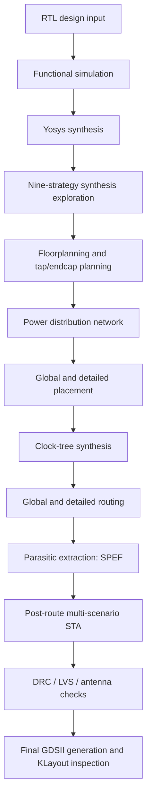
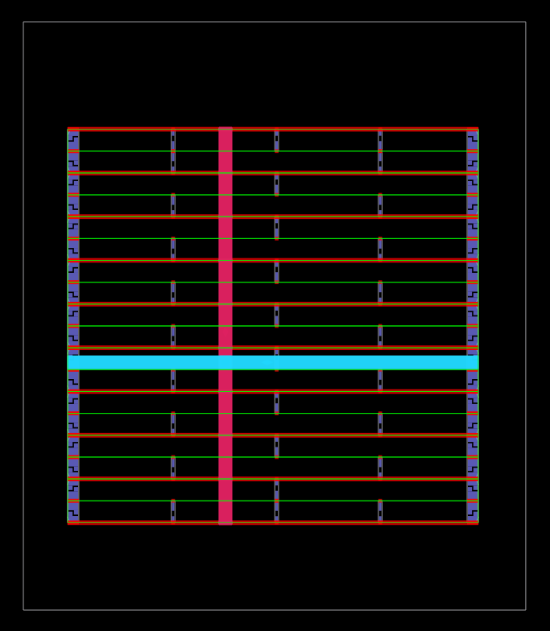
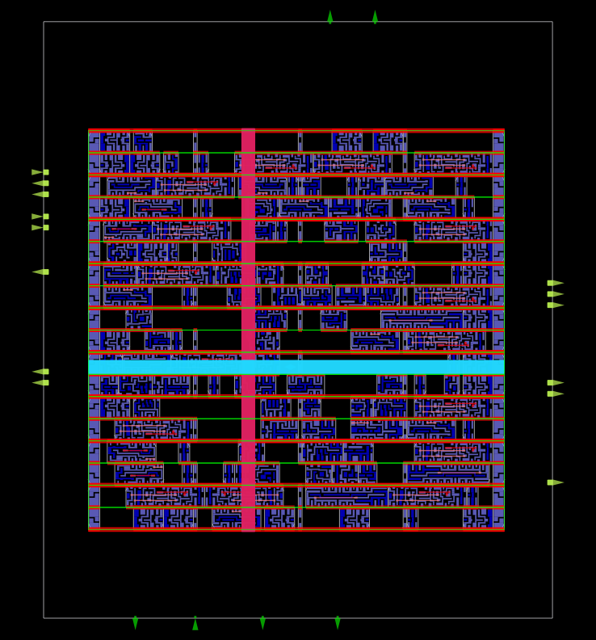
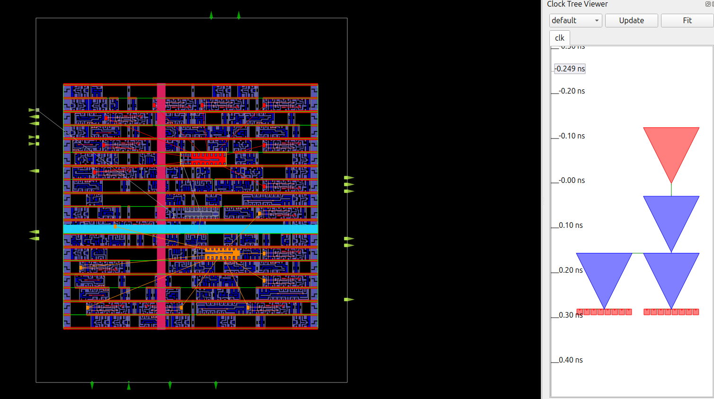
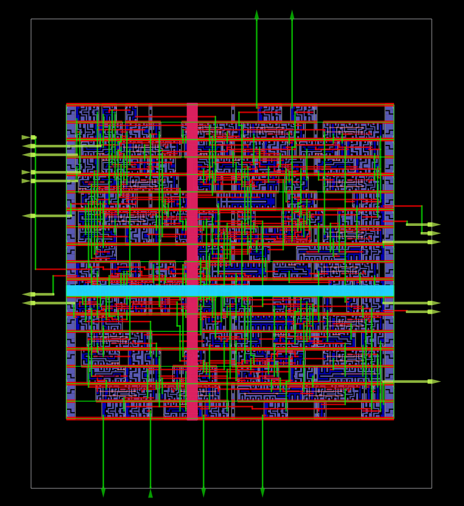
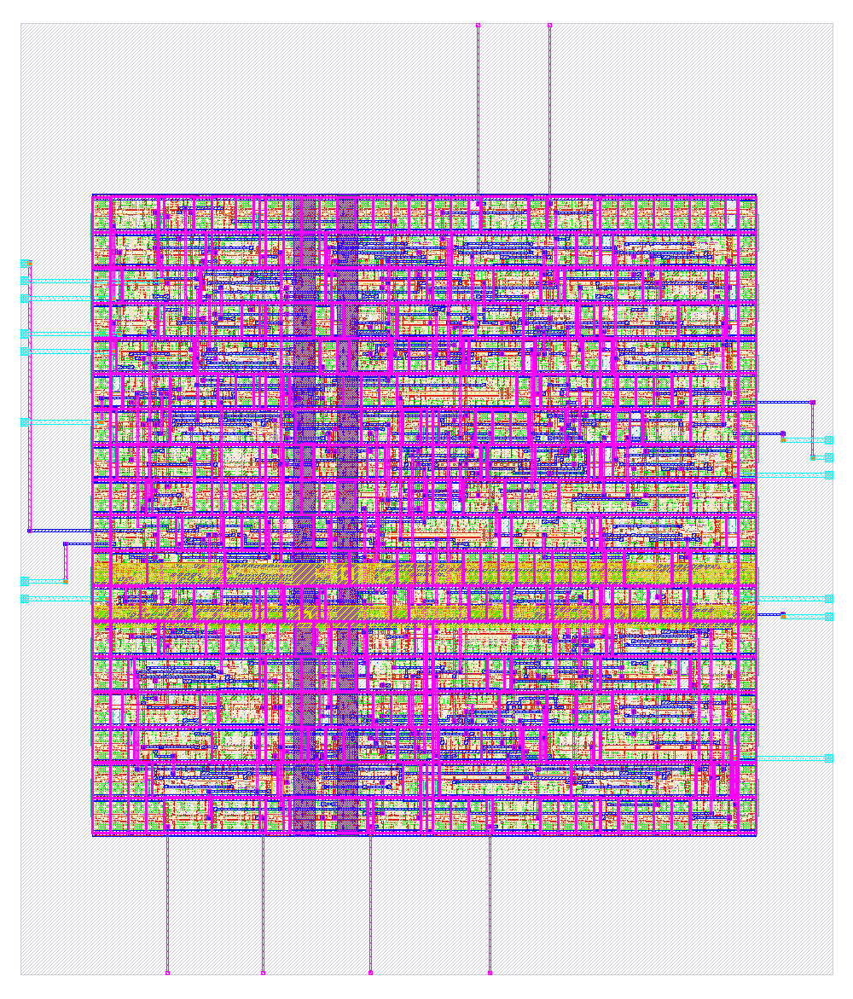

# 16-bit Counter — SKY130A RTL-to-GDSII Physical Design

A physical-design implementation and analysis project for a 16-bit up/down counter using the **SKY130A** process and the `sky130_fd_sc_hd` standard-cell library. The work covers functional simulation, synthesis-strategy evaluation, the LibreLane Classic backend flow, parasitic extraction, post-route static timing analysis (STA), physical verification, and final GDSII generation.

> **Project focus:** This repository documents the physical-design flow, engineering decisions, measured implementation results, and layout inspection. The original RTL and testbench are intentionally not redistributed here.

## Project at a glance

| Item | Recorded configuration |
|---|---|
| Design | 16-bit up/down counter with enable |
| Top module used in the implementation | `counter_up_dwn` |
| Clock port / period | `clk` / 10 ns (100 MHz constraint) |
| Controls | `rst`, `en`, `ctrl` |
| Reset behavior | Asynchronous, active-high |
| PDK / standard-cell library | SKY130A / `sky130_fd_sc_hd` |
| Physical-design flow | LibreLane with OpenROAD |
| Selected synthesis strategy | `DELAY 4` after comparison of nine strategies |
| Functional simulation | 12 PASS / 0 FAIL |
| Physical-design execution | LibreLane + OpenROAD |

## Implementation flow

## Physical Design Stage Snapshots

The following snapshots show the saved implementation checkpoints from the completed LibreLane Classic flow.

### 1. Floorplan and Power Distribution Network

*Floorplan checkpoint after power distribution network generation.*

### 2. Detailed Placement

*Standard-cell layout after detailed placement.*

### 3. Clock-Tree Synthesis (CTS)

*Post-CTS physical layout with the OpenROAD Clock Tree Viewer showing the clock distribution hierarchy.*

### 4. Detailed Routing

*Post-detailed-routing layout showing the implemented interconnects.*

## Selected implementation results

| Metric | Recorded result |
|---|---:|
| Die area | 4,575.57 µm² |
| Core area | 2,499.90 µm² |
| Final standard-cell utilization | 70.5205% |
| Final total instances | 406 |
| Global-route wirelength / vias | 4,305 µm / 925 |
| Detailed-route wirelength / vias | 2,288 µm / 877 |
| Worst post-route setup slack | +3.709904 ns |
| Worst post-route hold slack | +0.109108 ns |
| Setup / hold TNS | 0 ns / 0 ns |
| DRC / LVS / antenna | Passed / Passed / Passed |

The timing results are **fallback-constrained baseline results**, not external-interface signoff. See [Results and Verification](docs/RESULTS_AND_VERIFICATION.md) for the exact assumptions, corner details, and unresolved limitations.

## Final layout preview

*This is a rendered layout preview. It is not a substitute for the GDSII database or a physical-verification report.*

## Toolchain

| Tool / platform | Recorded version or identifier |
|---|---|
| LibreLane | 3.0.16 |
| Yosys | 0.62 |
| OpenROAD | `dcf36133a369abc8f3c5e5738cd4d82e4903c0e0` |
| KLayout | 0.30.7 |
| Verilator | 5.044 |
| SKY130 PDK revision | `8afc8346a57fe1ab7934ba5a6056ea8b43078e71` (`2025.07.14`) |
| Environment | Nix development shell |

## Documentation

- [Technical Project Report](docs/PROJECT_REPORT.md) — design context, implementation stages, engineering work, and conclusions.
- [Results and Verification](docs/RESULTS_AND_VERIFICATION.md) — area, routing, timing, physical checks, constraints, and limitations.

## Important interpretation notes

- The run used LibreLane's generic fallback SDC: 10 ns clock, 2 ns input/output delays, 0.25 ns uncertainty, 0.15 ns clock transition, and 33.442 fF output load. These are generic assumptions, not an externally supplied interface timing specification.
- The Stage 55 clock report contains an unresolved `Virtual: yes / Propagated: no` label discrepancy, although timing paths show CTS network delays and propagated-clock annotations.
- The run warned that `VSRC_LOC_FILES` was not supplied. The IR-drop estimate must not be presented as validated power-integrity signoff.
- A repair/check stage reported two floating nets, while a later disconnected-pin report found zero disconnected pins. These are distinct checks and should not be conflated.
- Formal equivalence (EQY) was skipped; no formal-equivalence pass is claimed.
- This is an educational RTL-to-GDS implementation baseline, not a production tapeout/signoff claim.
