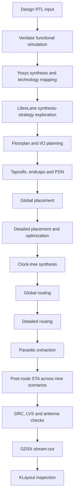

# Technical Project Report

## 1. Project overview

This project documents the physical implementation of a 16-bit up/down counter using the SKY130A process and `sky130_fd_sc_hd` standard-cell library. The main objective was to take the counter design input through a complete, inspectable RTL-to-GDSII backend flow and study how the synthesized logic becomes a placed, clocked, routed, and verified physical layout.

The documented engineering work centers on environment and PDK setup, Yosys synthesis, synthesis-strategy comparison, LibreLane Classic execution, stage-by-stage OpenROAD inspection, parasitic extraction, multi-scenario STA, physical checks, and final GDSII inspection.

## 2. Design context

The implementation is a 16-bit counter with enable, direction control, and an asynchronous active-high reset. The design interface used in the implementation is summarized below.

| Signal | Role | Behavior |
|---|---|---|
| `clk` | Clock input | State updates on the rising edge |
| `rst` | Reset input | Asynchronous, active-high; clears the count |
| `en` | Enable input | When low, the count holds its value |
| `ctrl` | Direction control | Low selects increment; high selects decrement |
| `count[15:0]` | Counter output | 16-bit counter state |

The counter arithmetic wraps at the 16-bit boundaries: incrementing `16'hFFFF` wraps to `16'h0000`, and decrementing `16'h0000` wraps to `16'hFFFF`.

The RTL was treated as the design input for this physical-design exercise. The focus of this report is backend implementation and analysis, not a claim of novel counter architecture.

## 3. Toolchain and technology

| Component | Recorded version / selection |
|---|---|
| Operating environment | Ubuntu VM with Nix development shell |
| LibreLane | 3.0.16 |
| Yosys | 0.62 |
| OpenROAD | `dcf36133a369abc8f3c5e5738cd4d82e4903c0e0` |
| KLayout | 0.30.7 |
| Verilator | 5.044 |
| PDK | SKY130A, revision `8afc8346a57fe1ab7934ba5a6056ea8b43078e71` |
| Standard-cell library | `sky130_fd_sc_hd` |

## 4. Functional verification and synthesis

The self-checking Verilator simulation completed with **12 PASS and 0 FAIL**. The recorded checks covered asynchronous reset, increment, decrement, enable hold, overflow, and underflow. A reset-deassertion race was corrected in the testbench by moving deassertion away from the active clock edge; the original RTL was not changed as part of that correction.

Yosys was used for synthesis and technology mapping. Nine synthesis strategies were explored in LibreLane SynthesisExploration. `DELAY 4` was selected for the recorded Classic baseline.

| Synthesis snapshot | Recorded value |
|---|---:|
| Selected strategy | `DELAY 4` |
| Mapped gate count | 106 |
| Synthesis area | 1,323.7696 µm² |

These are synthesis-stage values. They should not be confused with the final post-CTS / post-route area accounting, which includes physical-only cells and uses different reporting groupings.

## 5. RTL-to-GDSII implementation flow

### 5.1 Floorplanning and power planning

The recorded floorplan dimensions were:

| Region | Width | Height | Area |
|---|---:|---:|---:|
| Die | 62.495 µm | 73.215 µm | 4,575.57 µm² |
| Core | 51.06 µm | 48.96 µm | 2,499.90 µm² |

Tap cells, endcaps, and the power distribution network were included in the physical implementation. Area metrics later include physical-only cell categories; therefore, the reported final standard-cell area must be interpreted with its metric grouping in mind.

### 5.2 Placement and clock-tree synthesis

The design proceeded through global and detailed placement and optimization. The final reported standard-cell utilization was **70.5205%** of core area.

The recorded CTS checkpoint reported one clock-tree root, three clock buffers, three subnets, and 16 sinks. Thirteen hold-delay buffers were inserted during post-CTS repair. These are checkpoint-specific counts and should not be merged with final cell-master totals from a different stage.

### 5.3 Routing and parasitic extraction

The routing summaries were:

| Stage | Wirelength | Vias | Result |
|---|---:|---:|---|
| Global route | 4,305 µm | 925 | Zero global-route overflow reported |
| Detailed route | 2,288 µm | 877 | Final detailed-route violation count reached zero |

Parasitic extraction generated MIN, NOM, and MAX SPEF files. The subsequent timing summary covered nine combinations: three extraction conditions and three library PVT scenarios.

## 6. Post-route static timing analysis

The Stage 55 summary reported positive worst setup and hold slack across the evaluated scenarios.

| STA metric | Worst reported value |
|---|---:|
| Setup WNS | +3.709904 ns |
| Hold WNS | +0.109108 ns |
| Setup TNS | 0 ns |
| Hold TNS | 0 ns |
| Setup / hold violation counts | 0 / 0 |
| Max-capacitance / max-slew violations | 0 / 0 |
| Number of timing scenarios | 9 |

The worst setup scenario was `max_ss_100C_1v60`. The reported path started at input `ctrl` and ended at flip-flop `_195_`; data arrival was approximately 6.278806 ns and required time approximately 9.988710 ns.

The worst hold scenario was `min_ff_n40C_1v95`. The reported path was `_194_/Q` to `_194_/D`; data arrival was approximately 0.534635 ns and required time approximately 0.425526 ns.

The SDC values were generic fallback assumptions, not derived from an external system timing contract. The positive slack values therefore describe the recorded fallback-constrained baseline and should not be promoted as externally validated interface timing signoff or a guaranteed maximum operating frequency.

## 7. Physical verification and final layout

The completed run recorded:

| Check / deliverable | Recorded outcome |
|---|---|
| LibreLane Classic flow | 80/80 stages completed |
| DRC | Passed |
| LVS (Netgen) | Passed; unique circuit match reported |
| Antenna | Passed |
| Disconnected pins | 0 reported in the later check |
| Final GDSII | Generated |
| KLayout inspection | Final GDS opened in KLayout 0.30.7 |

The repository preview image is a rendered view of the final layout. The GDSII, PDK files, and full run directory are not included in this documentation pack.

## 8. Engineering limitations and interpretation

1. **Fallback SDC:** No project-specific external timing contract was available. The generic fallback constraints must be identified as assumptions.
2. **Clock report discrepancy:** Stage 55's clock report labels the clock `Virtual: yes` and `Propagated: no`, while timing-path annotations include CTS network delays and propagated-clock annotations. This discrepancy was not resolved in the recorded investigation.
3. **Power integrity:** The run warned that `VSRC_LOC_FILES` was not supplied. The IR-drop estimate is not validated power-integrity signoff.
4. **Floating-net warning:** One repair/check stage reported two floating nets, while a later disconnected-pin report found zero disconnected pins. The reports describe different checks and should both be retained in the local evidence archive.
5. **Router warning:** The detailed router reported unsupported LEF58 enclosure information for a cut layer. The flow completed, but the warning should remain visible in a technical review.
6. **Formal equivalence:** EQY was skipped; no formal-equivalence result is claimed.
7. **Wirelength checker:** The long-wirelength checker was skipped because a threshold was not configured.

## 9. Conclusion

The recorded implementation completed functional simulation, synthesis-strategy exploration, the 80-stage LibreLane Classic flow, post-route extraction and nine-scenario STA, physical checks, and final GDSII generation. The results provide a useful educational physical-design baseline with documented evidence and limitations. They do not establish production tapeout signoff.
